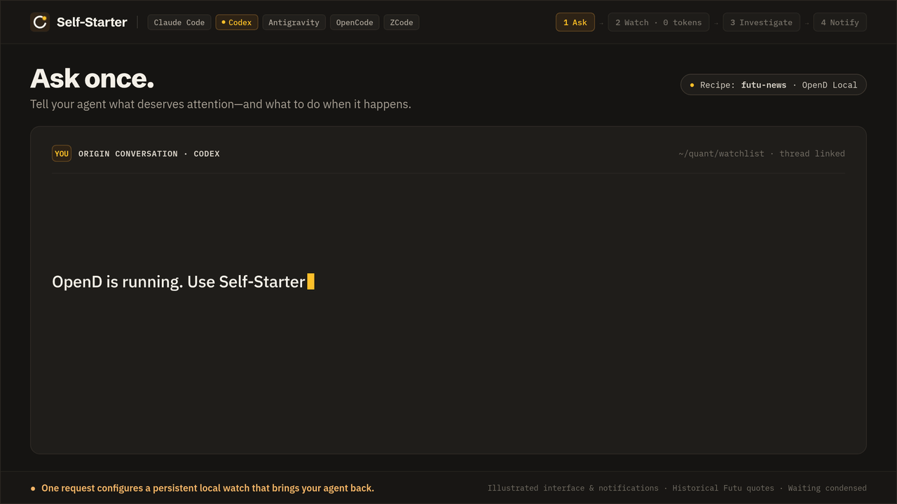

<h1 align="center">Self-Starter</h1>

<p align="center"><b>Local, zero-token event triggers for Claude Code, Codex, OpenCode and ZCode.</b><br>
CI failed? New PR comments? A training run finished—or NVDA just moved 6%?<br>
Local code keeps watch—even after you close your terminal—and brings the follow-up back to your conversation.</p>

<p align="center">
  <a href="https://hyprh.github.io/self-starter/"><b>Website</b></a> ·
  <a href="#demo">Demo</a> ·
  <a href="#what-this-plugin-solves">Why Self-Starter</a> ·
  <a href="#install">Install</a> ·
  <a href="#quick-start">Quick start</a> ·
  <a href="#what-to-watch">Use cases</a> ·
  <a href="docs/guide.md">Guide</a>
</p>

<p align="center">
  <a href="https://github.com/hyprh/self-starter/actions/workflows/ci.yml"></a>
  <a href="https://github.com/hyprh/self-starter/releases"></a>
  <a href="LICENSE"></a>
</p>

## Demo

**Keep working. Get the result when it is ready.** Here a Futu watch spots an unusual AMD move while you work elsewhere, Codex investigates what changed, and Self-Starter notifies your desktop—the same local engine watches your PRs, CI runs, GPUs and services:

<p align="center">
  
</p>

*Edited replay of a real Futu watch. The interface and desktop notification are illustrated; quotes are historical. For an engineering workflow, see [Investigate a new CI failure](docs/ci-watch.md).*

## What this plugin solves

Give your coding agent an ongoing responsibility: watch your PRs, long-running jobs, local services or market activity, and handle the follow-up with the context you already built.

**Ask once: "Keep watching this PR. When CI fails or new review comments arrive, investigate and continue in this conversation."** Your agent writes and tests a small local TypeScript probe, hands it to a background `launchd` or `systemd` service, and steps aside until the condition actually happens.

| When this happens… | Your agent picks up the next task |
|---|---|
| A new CI run fails on your commit | Read the failing job logs and suggest a fix ([walkthrough](docs/ci-watch.md)) |
| Your PR gets new review comments | Investigate the feedback and propose changes |
| Your training run finishes or `nvidia-smi` shows an idle GPU | Compare metrics with the last run or start the next experiment |
| A local or staging service stays down for two minutes | Inspect recent logs and trace the root cause |
| NVDA moves 6% or analysts change their rating | Investigate what changed and summarize sentiment ([`futu-news` recipe](recipes/futu-news)) |
| Your IBKR account report updates | Explain new trades, option assignments or cash movements ([`ibkr-account` recipe](recipes/ibkr-account)) |

### Why not built-in polling or cloud schedules?

| Approach | Tokens while waiting | Survives closing terminal / app? | Sees local files, GPUs & `localhost`? | Continues in your local conversation? |
|---|---|---|---|---|
| **In-session polling (`/loop`, thread timers)** | Calls the model on every check | No — stops when the session closes | Yes | Yes, while open |
| **Cloud routines & remote schedules** | Calls the model on every scheduled run | Yes (runs in the cloud) | No — isolated from your machine & LAN | No — starts separate cloud runs |
| **Self-Starter** | **Zero** during routine probe checks | **Yes** (`launchd` / `systemd` service) | **Yes** (logs, `nvidia-smi`, CLIs, APIs) | **Yes** in Codex & Claude Code; dedicated CLI session in OpenCode & ZCode |

**Closing your terminal or app does not end the watch.** While your machine is awake, an independent local service keeps running the probe and enforces state transitions (`not-met → met`), minimum duration, deduplication, cooldowns and expiry. **Code does the waiting. Your agent does the work.** Routine checks make no model calls; setup, session initialization and agent actions can still use tokens.

Repeating watches use a dedicated result session by default. In Codex and Claude Code, ask to **continue in this conversation** to keep follow-ups in your original thread (delivered between turns while open, or resumed in the background when closed). See [where the agent answers](docs/guide.md#where-codex-answers) and the platform-specific destinations below.

## Install

Choose the integration for your agent. All four share the same local trigger engine; their installation and result destinations differ.

| Agent | Installation | Where the agent answers |
|---|---|---|
| **[Codex](#codex)** | GitHub plugin marketplace | The original conversation or a dedicated thread |
| **[Claude Code](#claude-code)** | GitHub plugin marketplace | The original session or a dedicated session |
| **[ZCode](#zcode)** | Local source installation from v0.0.4 | A dedicated CLI result session; no delivery into the original desktop conversation |
| **[OpenCode](#opencode)** | Local source installation from v0.0.4 | A dedicated CLI result session, reused for later events |

You need **macOS or Linux**, [Node.js](https://nodejs.org) **20+** and your chosen agent configured with working model access. For the current ZCode CLI, use **Node.js 24.14.0+**.

### Codex

With the Codex CLI installed (`npm install -g @openai/codex` if needed):

```sh
codex plugin marketplace add hyprh/self-starter
codex plugin add self-starter@self-starter
```

Restart the Codex app, or start a new CLI session.

### Claude Code

Inside Claude Code:

```text
/plugin marketplace add hyprh/self-starter
/plugin install self-starter@self-starter
```

Use Claude Code 2.1.224 or newer for delivery into open sessions, then start a new session after installation. See the [Claude Code guide](docs/guide.md#claude-code) for session delivery and permissions.

On their first start, the Codex and Claude Code plugins download the matching runtime (about 50 MB, including [Deno](https://deno.com)) and set up a launchd or systemd background service. Allow a minute or two; later starts need no download. The terminal command is `~/.self-starter/bin/self-starter`.

### ZCode

ZCode support has been available since **v0.0.4** and uses a local source installation. Install from a checkout of the [v0.0.5 tag](https://github.com/hyprh/self-starter/tree/v0.0.5):

```sh
npm ci
npm run build
node dist/src/cli/main.js install --zcode /absolute/path/to/zcode
node dist/src/cli/main.js doctor
```

Replace the placeholder with the absolute path to an authenticated ZCode CLI executable, not the desktop launcher. Keep the checkout available and start a new ZCode session. The installer registers a local marketplace and the background service. See the [ZCode guide](zcode-plugin/README.md) for setup, model access and permission modes.

### OpenCode

OpenCode support has been available since **v0.0.4** and uses a local source installation. Install from a checkout of the [v0.0.5 tag](https://github.com/hyprh/self-starter/tree/v0.0.5):

```sh
npm ci
npm run build
node dist/src/cli/main.js install --opencode /absolute/path/to/opencode
node dist/src/cli/main.js doctor
```

Use **OpenCode 1.x, version 1.19.3 or newer**, with working model access. Keep the checkout available and start a new OpenCode session after installation. The installer adds a native plugin loader without changing your OpenCode configuration. Each watch uses a dedicated result session; later events resume that session through the CLI, including when the UI is closed. Delivery into the conversation where you created the watch is not supported. See the [OpenCode guide](opencode-plugin/README.md).

<a id="try-it-in-two-minutes"></a>

## Quick start

Test the three things built-in timers cannot do—**filtering noise at zero tokens, surviving a closed terminal, and resuming your conversation**—with no API key or external service.

1. Remove any leftover log (`rm -f /tmp/self-starter-demo.log`), open your agent in a project folder that has a `README.md`, and ask:

   > Watch `/tmp/self-starter-demo.log` for the next hour (within ~10s latency). Ignore `INFO` lines—wake up once only when an `ERROR` line appears, include the matching log lines in the event data, inspect the file it names in this folder, and summarize what to check. Keep the task read-only, and confirm after activation that the first check did not fire.

2. Once confirmed, **close your agent completely** (`exit` in Claude Code, or quit the Codex / OpenCode session). In a normal shell, write routine noise first:

   ```sh
   echo "INFO: healthcheck ok" >> /tmp/self-starter-demo.log
   ```

   Wait 15 seconds: local code checks the log with **zero model calls** and ignores the `INFO` line (`~/.self-starter/bin/self-starter list` shows the latest check summary).

3. Now write an error while your agent is still closed:

   ```sh
   echo "ERROR: broken anchor or installation step in README.md" >> /tmp/self-starter-demo.log
   ```

4. Within ~30 seconds, Self-Starter spots the `ERROR` line and runs the follow-up in the background:
   - **Codex and Claude Code** resume the closed conversation where you created the watch (`claude --resume` or reopen Codex to find the analysis already waiting).
   - **ZCode and OpenCode** run the task in a dedicated CLI result session.

   Run `~/.self-starter/bin/self-starter history` (or `node dist/src/cli/main.js history` from a source checkout) to see the fire, receipt and destination—such as `(your session, resumed in the background)`—then delete the demo watch and `/tmp/self-starter-demo.log`.

For a live GitHub workflow, try [watching a CI failure](docs/ci-watch.md).

## What to watch

Anything a small program can check. Your agent writes the probe, tries it once, and sets up the watch with the action you authorize.

| Watch | Ask your agent | Source |
|---|---|---|
| **Long jobs** | "When the training run finishes, compare it with the last one." | A log or output file |
| **GPU availability** | "When the GPU is idle for ten minutes, start the next experiment." | `nvidia-smi` |
| **PR reviews** | "When my PR gets new review comments, investigate them and propose changes." | GitHub pull requests |
| **Issues** | "When a new issue is labelled bug, read the report and suggest where to investigate." | GitHub Issues |
| **CI** | "When CI fails on main, investigate and suggest a fix." | GitHub Actions ([guide](docs/ci-watch.md)) |
| **Releases** | "When a new version of zod is out, try it on a branch." | The npm registry |
| **Services** | "If the dev server is down for two minutes, find out why." | A health endpoint |
| **Files** | "When a new invoice lands in invoices/, add it to expenses.csv." | A local folder |
| **Research** | "When a speculative decoding paper hits arXiv, summarize it." | The arXiv API |
| **Markets** | "Tell me when analysts change their view on Tencent." | Futu research ([recipe](recipes/futu-news)) |
| **Accounts** | "Watch my IBKR account for anything unusual." | IBKR Flex reports ([recipe](recipes/ibkr-account)) |

These examples need access to their data sources. Network access and credentials for a probe and its later agent task are configured separately; the [CI guide](docs/ci-watch.md) walks through that distinction.

## How it works

1. **Describe the event.** Your agent writes a TypeScript probe or uses a ready-made recipe, tests it, and sets the action and destination.
2. **Code does the waiting.** A local background service runs the probe on a schedule. The engine handles minimum duration, cooldown, deduplication, expiry and delivery retries without calling a model for each check.
3. **Your agent does the work.** When the event fires, the task goes to the destination shown above. Codex and Claude Code can resume closed conversations in the background; ZCode and OpenCode resume their dedicated result sessions. You can choose a notification without an agent task instead.
4. **Check the result—or route it anywhere.** Run `~/.self-starter/bin/self-starter ui` (`self-starter ui` when on PATH) to open the local **Attention Inbox**, inspect 0-token check counts and active watches, copy one-click session resume commands, and route alerts per watch to **Desktop**, **Feishu / Lark**, **WeCom**, **DingTalk**, **Slack**, **Discord**, **Telegram**, **Bark**, **ntfy**, custom **Webhooks**, or [Email](docs/guide.md#notifications-and-outbound-channels).

## Running locally

- **Keep the machine awake.** Checks run locally, including when the agent app is closed. External data sources also need connectivity.
- **Review what can run.** Probes run as your user by default; API-only probes can use a restricted sandbox. Background agent tasks have separate permissions and cannot obtain interactive approval. ZCode and OpenCode use native tool permissions rather than OS isolation. See the [security policy](SECURITY.md), [ZCode permissions](zcode-plugin/README.md#permissions) and [OpenCode guide](opencode-plugin/README.md).
- **Verify delivery once.** Run the quick start on your own setup. Desktop notifications need a working notification service; on macOS, `terminal-notifier` enables clicks that open a Codex thread. Use the [Codex app checklist](docs/codex-app-checklist.md) to check foreground and background behavior.
- **Keep secrets out of chat.** API keys, webhook URLs, bot tokens and email app passwords are stored locally via `self-starter ui` or the CLI (`0600` permissions), never in chat or probe source. What a probe saw is passed to the agent as untrusted data.

## More

- [Guide](docs/guide.md): triggers, local Web console (`self-starter ui`), outbound push channels, secrets and CLI commands
- [ZCode guide](zcode-plugin/README.md): local installation and dedicated result sessions
- [OpenCode guide](opencode-plugin/README.md): native plugin installation and background result sessions
- [Design](docs/design.md): architecture, execution boundaries and verification
- [Changelog](CHANGELOG.md)
- Development: from a clone, `npm install && npm link && self-starter install` installs the plugin for supported agents it finds. `npm test` runs unit and integration tests. CI checks installation on macOS and Linux, agent delivery with real CLIs and a stand-in model, and email delivery.

## License

[MIT](LICENSE)
