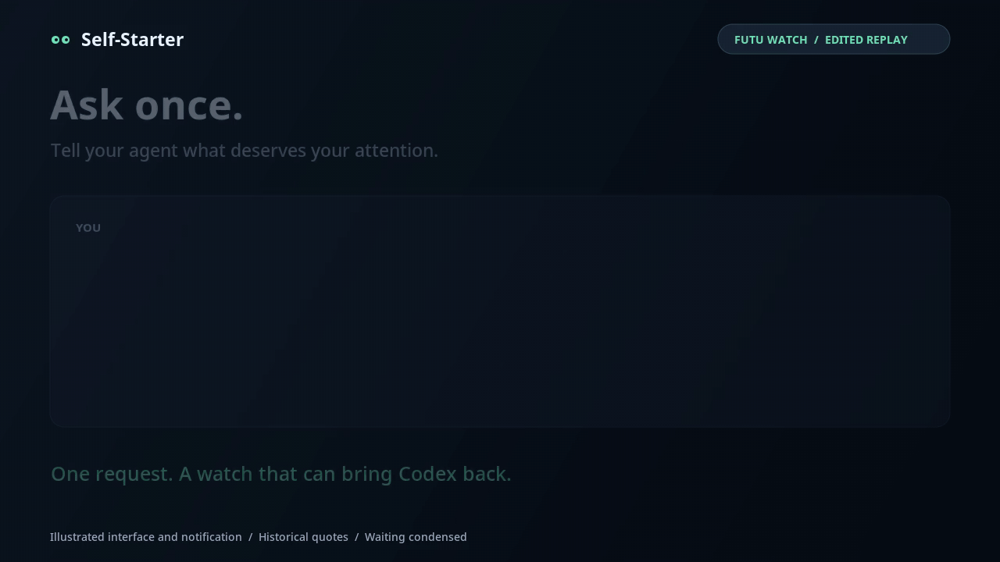

<h1 align="center">Self-Starter</h1>

<p align="center"><b>Give Codex eyes.</b><br>
Tell Codex what to keep an eye on. A small probe watches it on your machine without spending tokens,<br>
and when something changes, Codex comes back to your conversation with what it found and what it did.<br>
Get a desktop notification when the result needs your attention.</p>

<p align="center">
  <a href="https://hyprh.github.io/self-starter/"><b>Website</b></a> ·
  <a href="#demo">Demo</a> ·
  <a href="#install">Install</a> ·
  <a href="#what-to-watch">Use cases</a> ·
  <a href="docs/guide.md">Guide</a> ·
  <a href="docs/design.md">Design</a>
</p>

<p align="center">
  <a href="https://github.com/hyprh/self-starter/actions/workflows/ci.yml"></a>
  <a href="https://github.com/hyprh/self-starter/releases"></a>
  <a href="LICENSE"></a>
</p>

```sh
codex plugin marketplace add hyprh/self-starter
codex plugin add self-starter@self-starter
```

In Claude Code ([how it works there](docs/guide.md#claude-code)):

```
/plugin install self-starter --marketplace hyprh/self-starter
```

## Demo

**Keep working. The result comes to your desktop.** A Futu watch spots an unusual move, Codex investigates it, and Self-Starter can notify you with the result.

<p align="center">
  
</p>

*Edited replay of a real Futu watch. The interface and desktop notification are illustrated; quotes are historical.*

```
You:    When the run in runs/exp42 finishes, compare it with exp41.
Codex:  I'll check the end of its log every two minutes and compare the runs here. Start it?
You:    Yes.
        ...four hours later, in the same conversation, even if Codex was closed:
Codex:  exp42 finished: val loss 0.412 vs 0.437 for exp41, same accuracy. Keep exp42.
```

## What to watch

Anything a few lines of code can check: a file, a command, a local service, a web page or API. Ask Codex in one sentence; it writes the probe, tries it once and turns it on.

| | Ask Codex | Self-Starter watches |
|---|---|---|
| **Long jobs** | "When the training run finishes, compare it with the last one." | the end of the training log |
| | "When the GPU is idle for 10 min, start the next experiment." | `nvidia-smi` |
| **Code** | "Whenever CI fails on main, find the cause and propose a fix." | `gh run list` |
| | "When my PR gets review comments, address them and push." | `gh pr view` |
| | "When a new version of zod is out, try it on a branch." | the npm registry |
| **Services** | "If the dev server is down for two minutes, find out why." | the health endpoint |
| | "When a new error shows up in logs/app.log, find the cause." | the log file |
| **Reading** | "When a speculative decoding paper hits arXiv, sum it up." | the arXiv API |
| | "When Codex comes up on Hacker News, tell me what people say." | Hacker News search |
| **Files** | "When a new invoice lands in invoices/, add it to expenses.csv." | the folder |
| **Markets** | "Tell me when NVDA closes above $235, with the numbers." | the daily close |
| | "Tell me when analysts change their view on Tencent." | Futu research ([`futu-news`](recipes/futu-news)) |
| | "Watch my IBKR account for anything unusual." | IBKR Flex reports ([`ibkr-account`](recipes/ibkr-account)) |

## Install

You need macOS or Linux, [Node.js](https://nodejs.org) 20 or newer, and the Codex app or CLI (`npm install -g @openai/codex`). Then the two commands above, and restart the Codex app. In Claude Code, the one command above, then start a new session ([details](docs/guide.md#claude-code)).

The first time Codex starts the plugin, it downloads the rest of Self-Starter (about 50 MB, with [Deno](https://deno.com) for the probes) and sets up a small background service (launchd or systemd), so triggers keep running when Codex is closed. Secrets and email are set up in a terminal with `~/.self-starter/bin/self-starter`; see the [guide](docs/guide.md).

Or from a clone of this repository: `npm install && npm link && self-starter install`.

## Try it in two minutes

1. In a Codex conversation: "Tell me when /tmp/self-starter-demo/done appears, and what it says. Check every 10 seconds."
2. Close the Codex app if you like, then: `mkdir -p /tmp/self-starter-demo && echo "build finished" > /tmp/self-starter-demo/done`
3. Codex answers in that conversation and you get a notification. `~/.self-starter/bin/self-starter history` shows where it answered: `(your thread, open in Codex)` or `(your thread, opened in the background)`.

## How it works

<p align="center"></p>

- **Probes, not prompts.** Codex writes a few lines of TypeScript once; the background service runs them on a schedule. No model is called while waiting.
- **The engine owns the rules.** It fires only when the condition becomes true, with optional minimum duration, cooldown and limits, deduplicates events, retries, and tells you when a probe keeps failing. When a trigger turns out noisy, Codex can make it quieter on its own, never louder, and tells you.
- **The conversation answers by itself.** The task goes back to the conversation where you asked, or to a thread of the trigger's own. If Codex is closed, Self-Starter opens the conversation in the background. In Claude Code, the fire comes into your open session once Claude is done with what it is doing, or Self-Starter resumes the session in the background.
- **You stay in control.** Codex asks before turning on triggers that act for you. API keys are typed in a terminal, never in the chat. What a probe saw reaches Codex as data, not instructions.

## More

- [Guide](docs/guide.md): using triggers, where Codex answers, secrets, email, recipes, the command line
- [Design](docs/design.md): how it is built, and what was verified against Codex
- [Checklist for the Codex app](docs/codex-app-checklist.md): four checks on your machine, about ten minutes
- [Changelog](CHANGELOG.md)
- Development: `npm test` runs the unit and integration tests. CI also installs it for real on macOS and Linux, runs fires through the real Codex CLI with a stand-in model (`test/e2e/agent.ts`), and sends real email (`test/e2e/email.ts`).

## License

[MIT](LICENSE)
